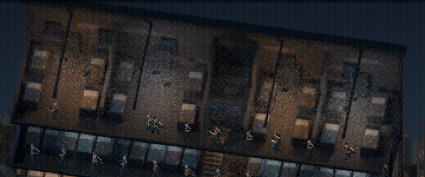
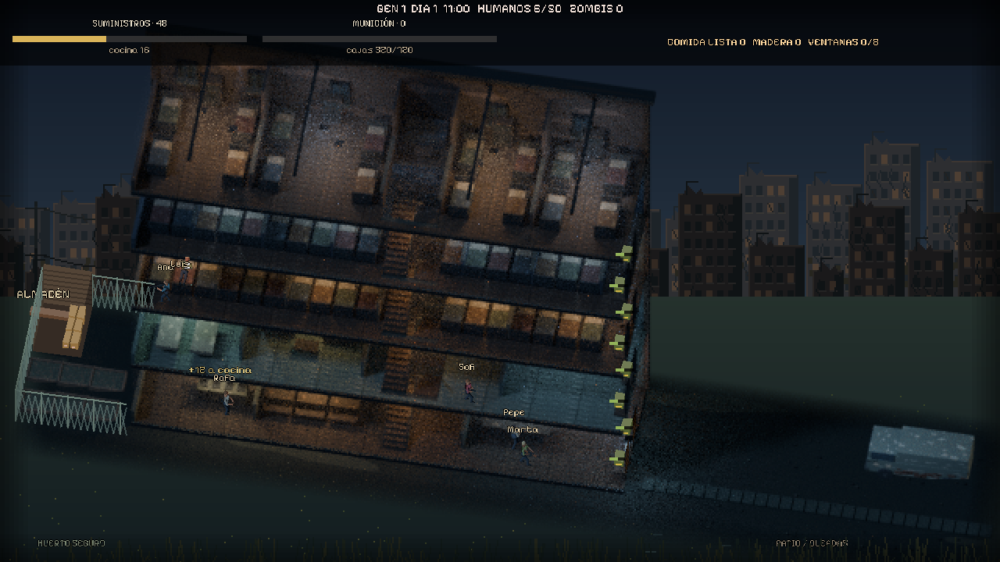
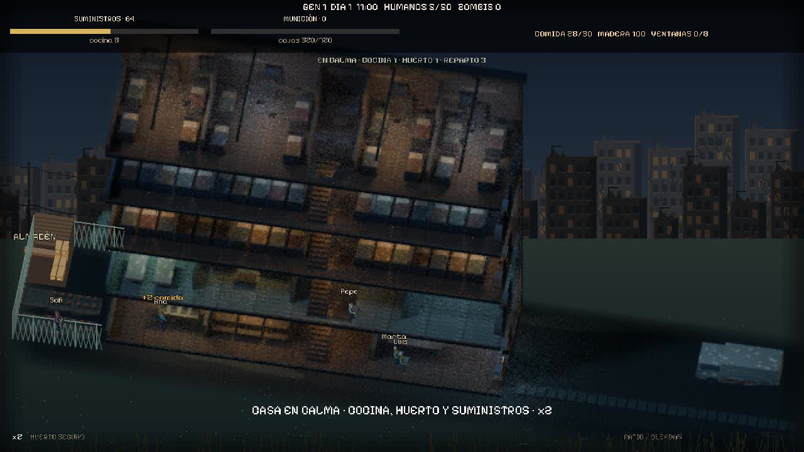
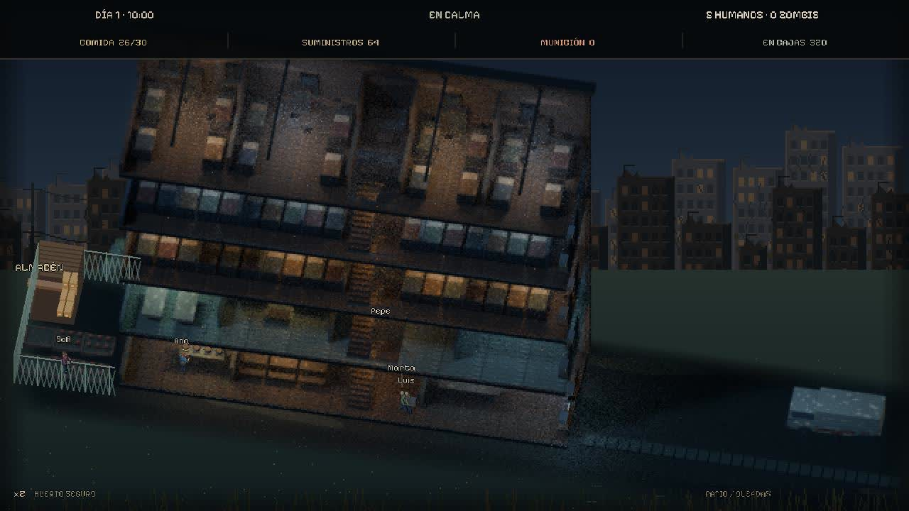

# Casa de Sobrevivientes — refugio de 50 personas

Juego de supervivencia pixel art para eventos de un directo de TikTok. Cinco plantas,
50 camas reservables, huertos protegidos al oeste y patio de invasion al este.
Los humanos trabajan, comen, duermen, defienden y reparan de forma autonoma.



[Captura completa de la partida](docs/partida-3d.png).

## Regalos e identidad

- **Likes y monedas:** 1 like = 1 zombi; cada moneda de cualquier regalo (Rose incluida) = 5 zombis.
- **GG:** el primer GG crea una persona con el nombre del usuario. GG posteriores
  entregan suministros, municion y mejoras de arma; nunca crean una segunda copia.
  Dos GG de Juanito crean a Juanito y le dan un primer paquete de equipo.
- Se ignoran espacios exteriores y diferencias de mayusculas para reconocer al usuario.
  Una identidad muerta no revive con GG en esa generacion: contribuye suministros.
  Una nueva generacion permite volver a participar.
- Los humanos reciben al azar pistola, AK o M4. GG repetidos mejoran el arma
  hasta cuatro niveles de daño/cadencia y pueden sustituir la pistola por un fusil.

La entrada es **un archivo local `eventos.jsonl`**, una linea por evento (lo escribe el puente de TikTok):

```json
{"usuario":"juanito","regalo":"like","cantidad":12}
{"usuario":"ana","regalo":"Rose","cantidad":1,"monedas":1}
{"usuario":"pepe","regalo":"Lion","cantidad":1,"monedas":29999}
{"usuario":"luis","regalo":"GG","cantidad":1,"monedas":1}
```

`cantidad` es la cantidad nueva del evento (no totales acumulados de un combo) y `monedas` el valor total del regalo.
`usuario` es el identificador de TikTok del espectador.

## Mapa y defensa

- Izquierda: seis huertos y arboles dentro de una malla permanente. La proteccion
  existe en la simulacion: los zombis no eligen objetivos ni atraviesan esa zona,
  incluso si caen las barricadas de la casa. Los humanos pasan por la puerta oeste.
- Centro: cocina comunitaria con cuatro puestos, comedor, despensa, taller,
  enfermeria y duchas decorativas, dos dormitorios compartidos y cuatro habitaciones en el atico, con 50 camas en total.
  Cada cama se reserva por planta y posicion. Se usa la escalera para cambiar de piso.
- Derecha: patio amplio y despejado; las barricadas estan exclusivamente en las dos ventanas de la planta baja.
  Los enemigos llegan exclusivamente desde el borde derecho.
- Ocho puestos de ventana, dos por planta en las primeras cuatro plantas. Cada
  puesto tiene un unico ocupante. Hasta ocho humanos disparan simultaneamente
  a enemigos del exterior; pasar al lado de una ventana no concede un noveno puesto.
- Cada ventana de planta baja tiene cinco tablas de 30 puntos; las superiores quedan libres. Los zombis arrancan tablas y
  pueden entrar cuando queda a cero. Las defensas destruidas permanecen en el mapa.
  Un humano llega al lugar y coloca una tabla cada 0,8 s, gastando una madera.
  Cada ventana se repara desde dentro, en su posicion y planta. No hay defensas de madera en el patio.
  Los ataques pueden destruir las tablas mientras los humanos las reconstruyen.

## Almacen y logistica

- Las donaciones de suministros (GG repetidos y otros regalos) ya **no** reparten nada por arte de magia:
  llegan al **almacen**, un cobertizo abierto al oeste, junto a los huertos. Tiene dos reservas:
  **suministros** (comida *sin cocinar*) y **municion**. Las cajas apiladas dentro reflejan lo que queda.
- **Indicador arriba** de la pantalla: dos barras (suministros y municion del almacen), con las
  existencias de la cocina y el total de las cajas de ventana. Avisa con "cajas vacias" o "SIN MUNICION".
- **Cajas de municion** junto a cada una de las 8 ventanas. El tirador recarga desde la caja de
  *su* ventana; si el cargador y la caja estan vacios, deja el puesto. Nadie dispara con municion del aire.
- **Alguien tiene que llevarla**: los humanos libres cogen municion del almacen (hasta 45 por viaje) y la
  llevan a la caja mas vacia, subiendo escaleras si hace falta. Como mucho tres a la vez, y nadie
  se disputa la misma caja.
- **Suministros**: se llevan del almacen a la cocina (12 por viaje) y *despues* alguien tiene que
  cocinarlos para que se conviertan en comida. La cosecha del huerto tambien va al almacen.
- La madera sigue siendo global (taller). Regresion: `tests/almacen.gd`.

## Vigilancia permanente

Siempre hay al menos un humano de guardia **en una ventana** (uno mas por cada 20 residentes), de dia y de
noche, haya zombis o no. Si el vigilante se cansa (poca energia o hambre) pide relevo y sigue en su puesto
hasta que otro llega; si muere o se va a luchar dentro, otro ocupa su sitio. Solo abandona la ventana
sin relevo en una emergencia (hambre extrema o agotamiento). Regresion: `tests/vigilancia.gd`.

## Conexion con TikTok LIVE

- **1 like = 1 zombi. Cada moneda de un regalo = 5 zombis** (30 monedas = 150 zombis; una Rose de 1 moneda = 5).
  **GG** sigue creando a la persona (y los GG repetidos dan suministros y armas).
- El puente `puente/tiktok.js` (Node) escucha el directo de `puente/config.json` (`tiktok`) con
  `tiktok-live-connector` y escribe una linea por evento en `eventos.jsonl`; el juego la lee cada medio segundo.
  Combina los eventos de like con el contador de likes de la sala, porque TikTok no avisa de cada toque.
- Arranque: doble clic en `ABRIR_TODO.bat` (abre juego y puente; la primera vez instala dependencias con npm,
  hace falta Node.js). Solo el puente: `EMPEZAR_TIKTOK.bat`. Probar sin directo: `node puente/tiktok.js --simular`.
- Los zombis salen escalonados (mas deprisa cuanto mas grande es la oleada) y la cola tiene tope de 600 para que
  un diluvio de likes no congele el directo. Los multiplicadores estan en `scripts/sim.gd`
  (`ZOMBIS_POR_LIKE`, `ZOMBIS_POR_MONEDA`, `MAX_COLA`). Pruebas manuales con teclas: L = 10 likes, M = 30 monedas.
- Regresion: `tests/donaciones.gd`.

## Ejecutar

Se ha probado con **Godot 4.6.3**, aunque `project.godot` conserva la etiqueta 4.7.

```sh
godot --path .
godot --path . -- --demo-50       # 50 residentes y ataque por el patio derecho
godot --path . -- --demo-hogar    # inspeccion domestica sin ataque inicial
```

Teclas: **R** rosa/zombis, **G** GG de un usuario nuevo, **T** GG de Tester
(repetir = equipo), **1–4** velocidad, **espacio** pausa.
Con muchos habitantes solo se muestran los nombres de los defensores o del
personaje bajo el raton para mantener la legibilidad.

En el entorno cloud, antes de ejecutar Godot:

```sh
export XDG_DATA_HOME=/workspace/.runtime/xdg-data
export XDG_CONFIG_HOME=/workspace/.runtime/xdg-config
export XDG_CACHE_HOME=/workspace/.runtime/xdg-cache
mkdir -p "$XDG_DATA_HOME" "$XDG_CONFIG_HOME" "$XDG_CACHE_HOME"
```

La vista utiliza un lienzo 640×360 escalado ×2. La camara ortografica tiene
52° de elevacion y 10° de azimut. El escenario se modela en volumen y se renderiza
a baja resolucion con Cycles: sombras de muebles, rebotes de luz y oclusion reales
quedan horneados en los PNG. No se ejecuta Blender mientras se juega.
La vista usa la misma proyeccion para humanos, zombis, disparos y huertos.
Los personajes reciben un tinte segun las lamparas de su planta y sombras direccionales. El gore incluye sangre con estelas, fragmentos con
rebotes y manchas persistentes. Las particulas y apendices respetan pausa y velocidad.

## Regenerar arte

PNG incluidos; para regenerarlos instala Pillow y ejecuta desde la raiz:

```sh
python3 tools/interiores.py             # distribucion y accesos de las 50 camas
python3 tools/escenario_pixel.py        # fondos lejanos
blender -b -t 4 -P blender/refugio.py    # casa, luces y objetos a 52 grados
```

`blender/refugio.py` requiere Blender 4.3 o posterior con Cycles CPU. Usa cuatro
hilos, mallas compartidas y PNG de 640×360 para la casa; hasta 512 muestras adaptativas en interiores, con dispersion volumetrica de polvo.
No requiere un denoiser externo. La furgoneta, arboles y huertos comparten la camara.
Las habitaciones tienen separaciones, materiales y mobiliario distintos: cocina y
comedor calidos, taller frio, enfermeria, salon, duchas, dormitorio compartimentado,
cuartos con escritorios y atico con vigas/almacenamiento.

La escalera central tiene dos tramos por planta, 12 peldaños por tramo,
contrahuellas de 20 cm y huellas de 25 cm, con rellano y pasamanos. Humanos y zombis
recorren ambos tramos y el rellano; la altura de los pies se ajusta a cada peldaño.
`blender/sprites.py` es el generador antiguo y sobrescribe el arte nuevo si se usa.

## Validacion

```sh
godot --headless --path . --editor --import --quit
godot --headless --path . --script res://tests/refugio.gd
godot --headless --path . --script res://tests/interiores.gd
godot --headless --path . --script res://tests/prueba.gd
```

`refugio.gd` valida regalos e identidad, capacidad/camas, ocho puestos y ocho
fusileros simultaneos, reconstruccion de defensas y proteccion de huertos.
`interiores.gd` valida puestos domesticos, recorrido de los peldaños y reparacion desde la planta de la ventana.
`prueba.gd` es una simulacion de 400 segundos que imprime resultados, sin aserciones.

Con un display, `--captura=1 --salida=/ruta/imagen.png` guarda una captura del juego.

## Animaciones y armas

Humanos y zombis son modelos 3D articulados. Piernas, rodillas, codos, manos,
cabeza y torso se animan de forma procedural para caminar, atacar, apuntar,
disparar, recargar, trabajar y caer. Las armas AK, M4 y pistola tambien son meshes.
La vista 3D se renderiza a 1280×720 sobre el escenario pixel art, con la misma
camara ortografica. Los atlas anteriores se conservan como referencia y no se usan
para dibujar a los personajes.

Cargadores y cadencia base: pistola 12 / 0,65 s; AK 30 / 0,18 s; M4 30 / 0,14 s.
Las recargas duran 1,6 / 2,5 / 2,1 segundos respectivamente. No se puede disparar
durante una recarga ni sin municion global; cada tiro descuenta una bala.
Prueba: `godot --headless --path . --script res://tests/armas.gd`.
Demo: `godot --path . -- --demo-armas`.
Grabacion (requiere display):
`godot --path . --script res://tools/grabar.gd -- --destino=/tmp/armas-frames`.

## Ventanas y balistica con geometria 3D

`scripts/ventanas_3d.gd` crea un SubViewport transparente con camara ortografica
leida de `arte/casa.json`, sin modificar la casa ni su camara. Las tablas son
MeshInstance3D con grosor, veta procedural, inclinaciones, clavos y sombras.
Hay dos ventanas con tablas, solo en planta baja, y cinco tablas por ventana. HP controla la visibilidad de cada
pieza; las ventanas rotas permanecen para poder reconstruirlas desde dentro.
Los zombis eligen una de las dos ventanas de la planta baja, se acercan a ella
y solo entran al romperla; la otra ventana intacta no bloquea esa entrada.

Cada tiro genera un proyectil Capsula 3D breve, un fogonazo con luz local,
un casquillo con gravedad y un impacto breve. Los eventos se consumen una sola
vez aunque el fotograma tarde mas que el disparo. Los efectos caducan y se
limitan a 128 para evitar acumulacion. Pausa y velocidad se respetan.
No hay trazadoras largas ni postes de madera en el patio.

Prueba de geometria/estado: `godot --headless --path . --script res://tests/ventanas_3d.gd`.
La grabacion acepta `--ventanas-danadas` para mostrar la reparacion automatica.

Las tablas se montan en el mismo plano X de la pared este, sin chaflan ni marco
saliente adicional. Sus extremos quedan dentro del ancho de la ventana y no se
colocan en pisos superiores. Los ocho puestos de tiro siguen disponibles.
Vida de los zombis: normal 18, corredor 12, bruto 55. Las demos usan esos mismos
valores; no se aumenta la vida de los enemigos para las grabaciones.

## Personajes 3D y navegacion entre muebles

El juego ya no dibuja los atlas 2D para humanos y zombis. `actor_3d.gd` construye
modelos articulados con proporciones humanas, ropa, cabeza, manos, articulaciones,
armas y utensilios modelados. Hay caminar, apuntar, retroceso, recarga, trabajar,
tumbarse/incorporarse y caida. Los modelos reciben las luces de su planta en
tiempo real y proyectan sombras; las capas de luz evitan iluminar a traves del suelo.
La atmosfera y los haces volumetricos de la casa se calculan con Cycles y quedan
horneados en el escenario. El render 3D dinamico funciona tambien en Compatibility.

`arte/interiores.json` comparte camas, accesos, habitaciones y huellas de muebles
entre Blender y `Navegacion`. Los recorridos usan AStarGrid2D, con margen para el
cuerpo. Humanos y zombis rodean las camas, mesas y tabiques. Solo al descansar se
anima el cuerpo sobre el colchon; la posicion logica se mantiene junto a la cama.
El atico tiene cuatro habitaciones de cuatro camas, armarios y un salon en el rellano;
las camas ya no se repiten en una hilera a lo ancho del edificio. Se mantienen 50 plazas.

`python3 tools/interiores.py` prepara la distribucion; despues
`blender -b -t 4 -P blender/refugio.py` exporta tambien los obstaculos de los muebles
reales. `-- --metadata-only` omite el render y actualiza solo metadatos.
`tools/sprites_pixel.py` y sus atlas quedan como referencia antigua.

Pruebas adicionales:

```sh
godot --headless --path . --script res://tests/rutas_camas.gd
godot --headless --path . --script res://tests/actores_3d.gd
```

La grabacion `tools/grabar.gd` acepta `--interior` para mostrar el acceso a las
camas del atico, usando los mismos modelos y recorridos que la partida.

### Ajustes del almacén y tipografía

Tipografía Pixelify Sans incluida bajo licencia OFL, con soporte para español y fuentes de respaldo para nombres de usuarios. Las ocho cajas dejan libre el acceso junto a las ventanas y los residentes las rodean al caminar. Los suministros deben cocinarse antes de comer; los avisos distinguen munición baja, agotada y pendiente de reparto.



### Comportamiento y defensa interior

Los residentes abandonan las ventanas al terminar la amenaza y mantienen su tarea hasta completarla, salvo necesidades urgentes o combate. Una invasión en su planta interrumpe el trabajo: disparan desde distancia, retroceden ante un enemigo cercano y recargan usando las cajas próximas. Los disparos interiores comprueban obstáculos. Cuando los zombis presionan las barricadas, ambos defensores de planta baja retroceden unos tres metros y disparan desde dentro. Las cajas de esa planta están detrás para poder recargar allí; no se obtiene munición de una caja lejana. Nadie repara junto a los atacantes: esperan cuatro segundos de seguridad tras despejar las tablas. Se eliminaron los fragmentos verdes y morados de las muertes; quedan salpicaduras oscuras limitadas.

Comprobaciones: `tests/comportamiento.gd`, `tests/retirada_barricada.gd` y `tests/efectos.gd`, además de las pruebas de armas, almacén, navegación e interiores.

### Vida en la casa durante la calma

Los residentes preparan seis raciones por persona, reponen primero la despensa cuando hace falta cocinar y atienden el huerto para mantener reservas. Los puestos de cocina son exclusivos: un cocinero para hasta seis residentes, hasta cuatro en una casa llena. Las tareas se completan antes de elegir la siguiente.

El reparto se ve con cajas sostenidas con ambas manos; al cocinar usan utensilios y aparece vapor. La cabecera muestra comida preparada frente al objetivo; con Tab se consulta cuántas personas cocinan, cultivan o reparten. Las cajas de munición son modelos 3D oscuros apoyados en cada planta, sin barras flotantes verdes. Solo hay barricadas en las dos ventanas de planta baja.



Regresión: `tests/vida_casa.gd` simula cuatro minutos sin zombis con cinco residentes y comprueba cocina, huerto, transporte, reservas y supervivencia.

### Presentación para el directo

Cabecera compacta con día, estado de la casa, residentes y zombis; una segunda fila muestra comida preparada, suministros en almacén, munición en almacén y balas repartidas a las cajas. Las alertas distinguen calma, ataque, brecha y final de partida. Solo se muestra un aviso a la vez.

Mantén **Tab** para ver tareas, madera, despensa, generación y puestos de tiro, además de los mensajes pequeños de actividad. Los bocadillos aparecen al pasar el cursor o consultar detalles. Los nombres cercanos se separan para no superponerse y la barra de salud se reserva para heridas importantes.

Los fogones tienen ollas 3D sobre las encimeras existentes; el calor y la luz cálida se encienden durante la cocina y se apagan suavemente al terminar.


